# SponFy — AI Sponsorship Operating System & Intelligence Platform

[](https://www.typescriptlang.org/)
[](https://nextjs.org/)
[](https://github.com/langchain-ai/langgraphjs)
[](https://vitest.dev/)
[](https://csrc.nist.gov/publications/detail/sp/800-38d/final)
[](LICENSE)

SponFy is an enterprise-grade sponsorship operating system built for college hackathons, technical conferences, academic summits, and student developer organizations. Powered by multi-model artificial intelligence, live web research extraction, and human-in-the-loop safety gates, SponFy streamlines the entire sponsorship lifecycle—from automated discovery and explainable fit scoring to deliverability-guaranteed outreach, inbound reply intelligence, meeting scheduling, and pipeline revenue tracking.

---

## Visual Table of Contents

| Section | Visual Type | Focus Area |
| :--- | :--- | :--- |
| **[1. End-to-End System Architecture](#1-end-to-end-system-architecture)** | System Flow Diagram | Global Edge, Serverless Compute, AI Engine, Storage |
| **[2. LangGraph & Multi-Model AI Pipeline](#2-langgraph--multi-model-ai-orchestration-pipeline)** | Orchestration Flowchart | Parallel web search, Llama 3.3 scoring, Gemini extraction |
| **[3. Six-Step Send-Guard Security Engine](#3-six-step-send-guard-security-engine)** | Gate Decision Flowchart | Non-bypassable human approvals, spacing, and quotas |
| **[4. Multi-Layer Deliverability Shield](#4-multi-layer-deliverability-shield)** | Verification Pipeline | DNS MX, SPF/DMARC, disposable filters, and AI check |
| **[5. 7-Factor Fit Scoring Breakdown](#5-transparent-7-factor-fit-scoring-algorithm)** | Mermaid Pie Chart & Matrix | 0–100 explainable sponsor evaluation breakdown |
| **[6. Inbound Reply & Intent Intelligence](#6-real-time-reply-sync--intent-classification-engine)** | NLP Decision Machine | Automation intent classification and question extraction |
| **[7. 4-Touch Follow-Up Cadence & Circuit Breakers](#7-automated-4-touch-follow-up-engine--circuit-breakers)** | Lifecycle Timeline Flow | Scheduled cadence and real-time auto-halting triggers |
| **[8. Meeting Scheduler & Morning Reminders](#8-meeting-calendar-scheduler--overview-reminders)** | Interaction Flowchart | Big calendar multi-slot scheduling and login popups |
| **[9. AES-256-GCM Cryptographic Vault](#9-cryptographic-storage--token-security-vault)** | Sequence Diagram | OAuth token encryption, IV handling, and tamper defense |
| **[10. Platform vs. Custom Architecture Matrix](#10-platform-infrastructure-vs-custom-engineered-components)** | Structured Comparison | Vercel Edge capabilities vs. bespoke SponFy modules |
| **[11. CI/CD DevOps & Test Pipeline](#11-continuous-integration--devops-pipeline)** | Build Pipeline Flow | GitHub Actions, TypeScript verification, and 174 tests |
| **[12. How to Use SponFy — Step-by-Step Operator Guide](#12-how-to-use-sponfy--step-by-step-operator-guide)** | End-to-End Walkthrough | Comprehensive step-by-step instructions from signup to closing |
| **[13. Organisation Model & Team Collaboration Architecture](#13-organisation-model--team-collaboration-architecture)** | Role & Flow Architecture | Roles, executive application, organiser approvals, and team management |
| **[14. Local Development Quickstart](#14-local-development-quickstart)** | Code Configuration | Step-by-step local bootstrap and environment schema |

---

## 1. End-to-End System Architecture

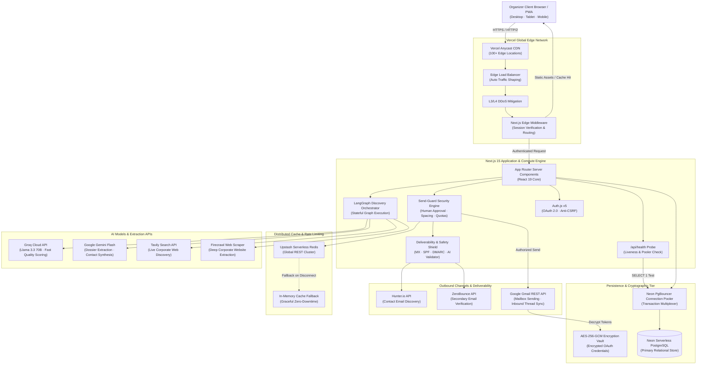

---

## 2. LangGraph & Multi-Model AI Orchestration Pipeline

SponFy integrates **LangGraph** as an orchestration layer over live discovery and dossier synthesis, executing parallel web research, fast LLM relevance filtering, and deep factual synthesis.

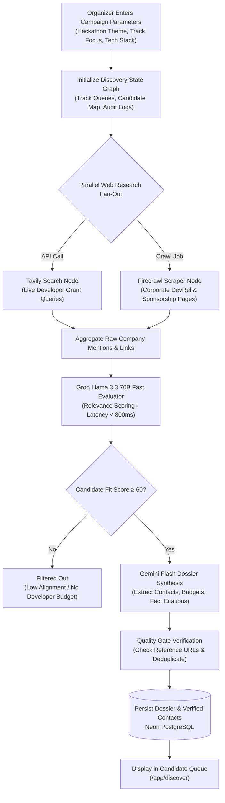

---

## 3. Six-Step Send-Guard Security Engine

To eliminate unauthorized spam and accidental transmissions, **all outbound emails** must pass through a strict, pure-function validation chain executed entirely on the server.

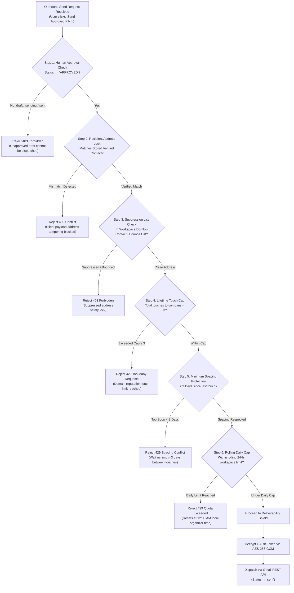

---

## 4. Multi-Layer Deliverability Shield

Bounces permanently harm domain reputation. SponFy prevents bad sends before they leave the application:

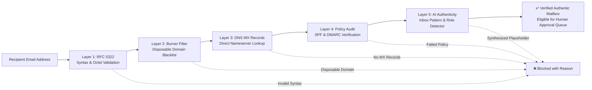

---

## 5. Transparent 7-Factor Fit Scoring Algorithm

Prospective sponsors are scored on an explainable **0–100** scale across seven dimensions before entering the outreach pipeline:

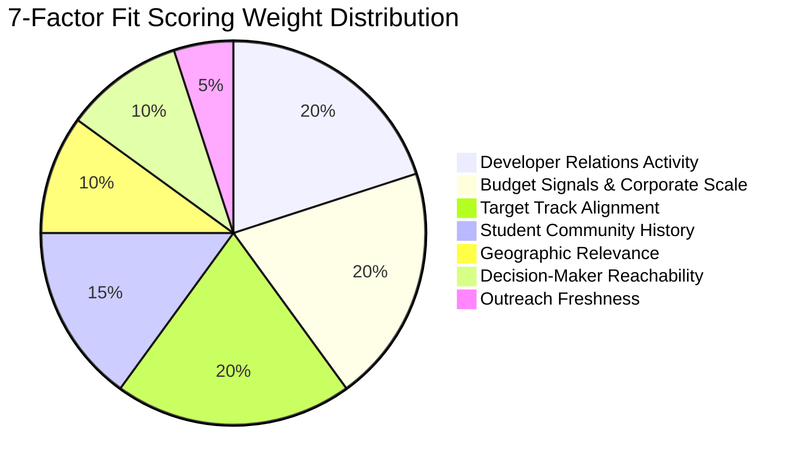

### Scoring Criteria Matrix

| Dimension | Weight | Signals Analyzed | Target Threshold |
| :--- | :---: | :--- | :--- |
| **Developer Relations Activity** | **20%** | Active developer advocates, GitHub initiatives, OSS programs | Recent active hackathon involvement |
| **Budget Signals & Scale** | **20%** | Recent funding rounds, dedicated university grants, hiring | Verified student grant budgets |
| **Target Track Alignment** | **20%** | Semantic match between API/product and hackathon tracks | High relevance to student projects |
| **Student Community History** | **15%** | Track record of sponsoring college clubs, summits, or fellows | Prior university sponsorship evidence |
| **Geographic Relevance** | **10%** | Regional developer hubs, regional hiring campaigns | Event country or global remote policy |
| **Decision-Maker Reachability** | **10%** | Verified DevRel, University Relations, or Tech Recruiting emails | Named contact with public role |
| **Outreach Freshness** | **5%** | Recency of last public sponsorship announcement | Partnership announced in past 6 months |

---

## 6. Real-Time Reply Sync & Intent Classification Engine

SponFy actively listens for incoming replies across connected Gmail threads and passes incoming text through an NLP intent classification pipeline:

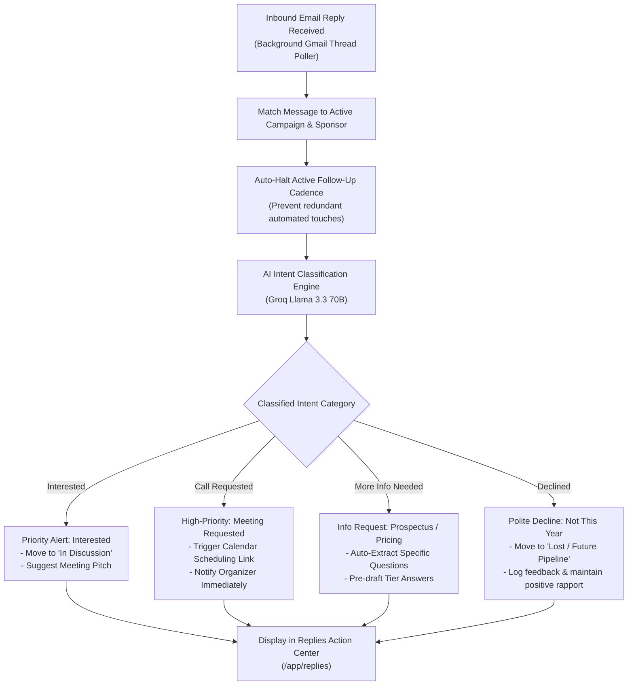

---

## 7. Automated 4-Touch Follow-Up Engine & Circuit Breakers

A structured 4-touch cadence ensures maximum reply rates while strictly protecting sender reputation. Any inbound activity triggers an immediate circuit breaker.

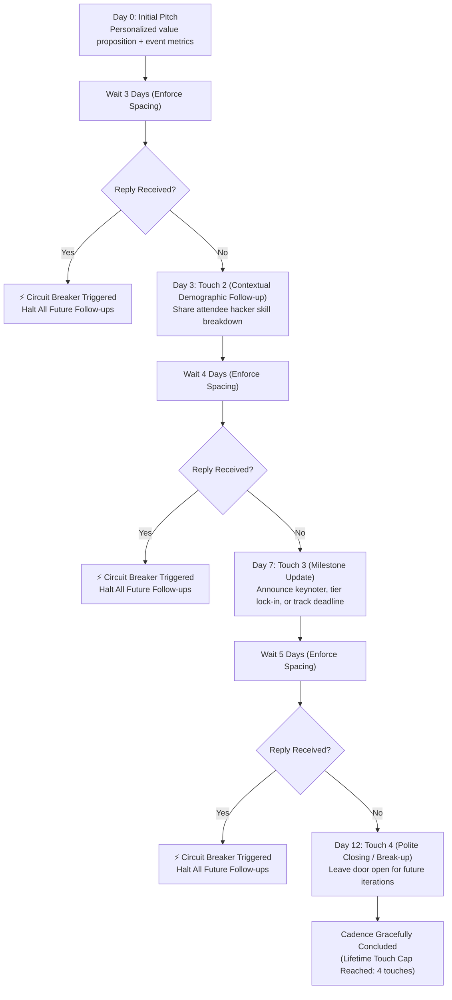

---

## 8. Meeting Calendar Scheduler & Overview Reminders

Organizers can manage all sponsor meetings through an interactive, full-screen calendar with morning reminder notifications on login.

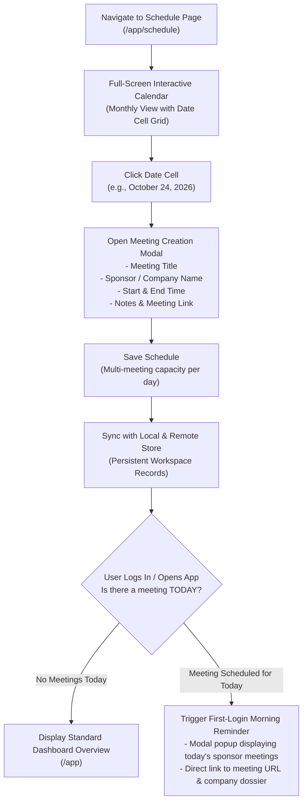

---

## 9. Cryptographic Storage & Token Security Vault

All OAuth refresh tokens and sensitive API keys are encrypted at rest using **AES-256-GCM** with authenticated tamper verification.

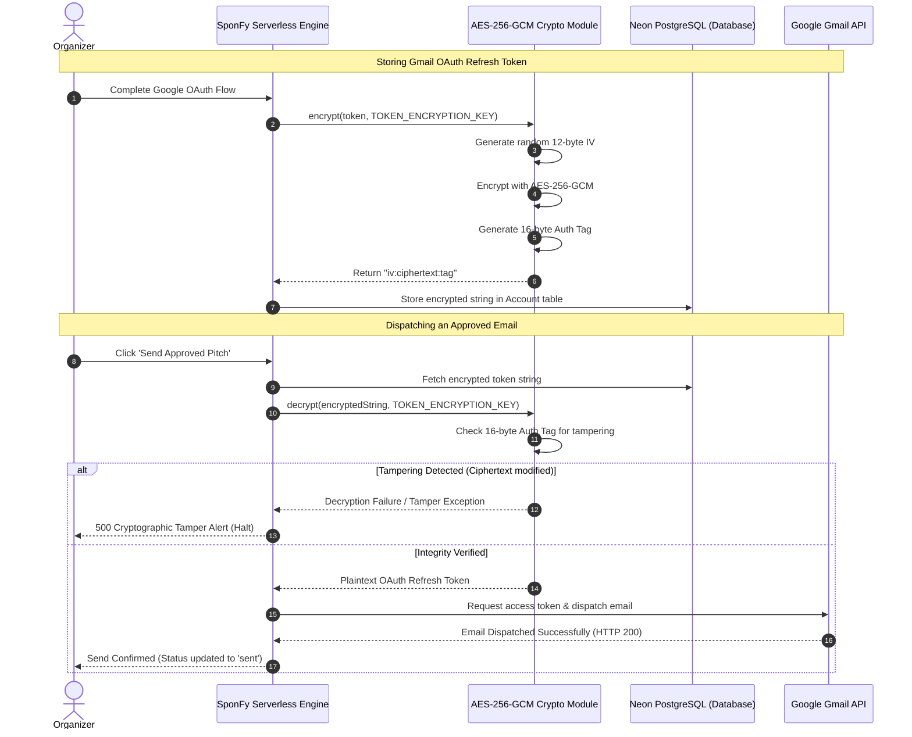

---

## 10. Platform Infrastructure vs. Custom-Engineered Components

SponFy achieves high availability by cleanly dividing concerns between Vercel's global platform infrastructure and custom-engineered business logic.

```mermaid
graph LR
    subgraph PlatformInfrastructure ["Platform-Provided (Vercel Global)"]
        P1["Anycast Global CDN<br/>(100+ Edge Locations)"]
        P2["Edge Load Balancing<br/>(Auto Request Routing)"]
        P3["Serverless Auto-Scaling<br/>(0 to Hundreds of Instances)"]
        P4["L3/L4 DDoS Mitigation<br/>(Volumetric Attack Defense)"]
        P5["Edge Middleware<br/>(Sub-10ms Session Check)"]
    end

    subgraph CustomEngineered ["Custom-Engineered (SponFy Core)"]
        C1["Send-Guard Security Engine<br/>(Pure-function safety gate)"]
        C2["Deliverability Shield<br/>(MX / SPF / DMARC verification)"]
        C3["LangGraph Discovery Engine<br/>(Stateful multi-model AI graph)"]
        C4["AES-256-GCM Crypto Vault<br/>(Tamper-evident token security)"]
        C5["Midnight Quota Engine<br/>(Rolling 12:00 AM reset calculator)"]
        C6["7-Factor Fit Scoring<br/>(0–100 explainable sponsor rating)"]
    end

    PlatformInfrastructure -->|Low Latency Routing & Protection| CustomEngineered
```

---

## 11. Continuous Integration & DevOps Pipeline

Every pull request and commit to `main` undergoes an automated multi-stage verification pipeline to ensure zero regressions:

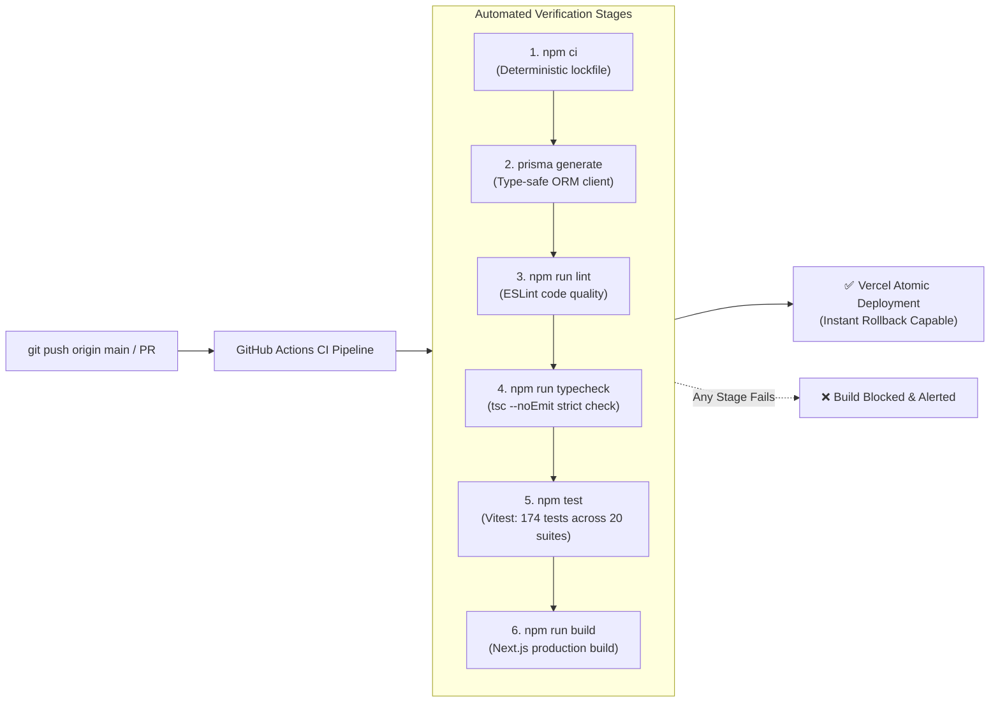

---

## 12. How to Use SponFy — Step-by-Step Operator Guide

Follow this chronological operator guide to launch your event campaign, discover aligned corporate sponsors, generate tailored pitches, safely dispatch outreach, and convert responses into signed partnerships.

```mermaid
flowchart LR
    S1["1. Register & Profile<br/>(/signup · /onboarding)"] --> S2["2. Choose Mode<br/>(Individual · Organiser · Exec)"]
    S2 --> S3["3. Create Campaign<br/>(Tiers · Tracks · Goals)"]
    S3 --> S4["4. AI Discovery<br/>(LangGraph · Tavily · Fit Score)"]
    S4 --> S5["5. Deliverability Shield<br/>(MX · SPF · Disposable Filter)"]
    S5 --> S6["6. Pitch Review & Approval<br/>(Human-in-the-Loop Gate)"]
    S6 --> S7["7. Send-Guard Dispatch<br/>(Gmail API · Quota Checks)"]
    S7 --> S8["8. Automated Cadence<br/>(4 Touches · Auto-Halting)"]
    S8 --> S9["9. Inbound Intent AI<br/>(Interested · Meeting Links)"]
    S9 --> S10["10. Meeting Scheduler<br/>(Calendar · Morning Alerts)"]
    S10 --> S11["11. Close Sponsorship<br/>(Analytics · Committed ₹)"]
```

### Step 1: Sign Up & Complete Profile
1. Navigate to [`/signup`](file:///src/app/(auth)/signup/page.tsx) to create an account with email and password, or use one-click **Google OAuth** or **GitHub OAuth**.
2. Upon first sign-in, you are directed to the **Onboarding Profile Step** ([`/onboarding`](file:///src/app/onboarding/page.tsx)).
3. Fill out your verified operator credentials:
   - **Full Name**: Your legal or professional name.
   - **Phone Number**: Direct contact for team communication.
   - **Designation / Title**: e.g., *Head of Corporate Partnerships*, *Lead Organizer*, or *Student Developer Advocate*.
   - **College or Company**: Name of your university, club, company, or organizing institution.
   - **Department**: e.g., *Computer Science Society*, *Student Council*, or *Engineering Fest Committee*.
4. Click **Save & Continue** to transition to Step 2.

---

### Step 2: Choose Your Operating Mode
In Step 2 of onboarding, choose how you will operate in SponFy:
- **Path A: Individual Organizer (`USER`)**:
  - Best for independent creators running a one-off hackathon, workshop, or personal summit with no team hierarchy.
  - Instantly unlocks the personal dashboard ([`/app`](file:///src/app/(app)/app/page.tsx)) with standalone campaign controls.
- **Path B: Create an Organisation (`ORGANISER`)**:
  - Best for society presidents, fest convenors, or club leads.
  - Sets up an **Organisation Workspace**, creates your first campaign, and gives you master approval rights over team executives.
- **Path C: Join as Executive (`EXECUTIVE`)**:
  - Best for sponsorship committee members, marketing executives, or student volunteers.
  - Search for your college club or fest, submit an access application, and wait for the lead organizer's approval.

---

### Step 3: Setup & Configure Your Campaign
1. Open [`/app/campaigns`](file:///src/app/(app)/app/campaigns/page.tsx) (or complete the new campaign form during organiser onboarding).
2. Define event parameters:
   - **Event Name**: e.g., *HackApex 2026*, *National AI Summit*.
   - **Event Type**: *Conference & Summit*, *Hackathon*, *Cultural Event*, or *Community Meetup*.
   - **Audience Scale**: Expected in-person and virtual attendees (e.g., 800+ developers).
   - **Location**: Event host city and venue.
   - **Target Funding Goal**: Total sponsorship target in Indian Rupees (₹ INR).
   - **Preferred Industries**: Target sponsor verticals (e.g., *Developer Tools*, *AI & Machine Learning*, *Cloud & DevOps*, *FinTech*).
   - **Sponsorship Tiers**: Customize Title, Platinum, Gold, and Silver tiers with pricing, booth sizes, keynote speaking slots, and branding perks.
   - **Pitch Deck URL**: Direct link to your public pitch deck PDF or Notion document.

---

### Step 4: Autonomous AI Sponsor Discovery & 7-Factor Fit Scoring
1. Go to **AI Discovery** at [`/app/discover`](file:///src/app/(app)/app/discover/page.tsx).
2. Select your active campaign and launch the discovery job.
3. SponFy's **LangGraph Discovery Orchestrator** fans out live research across Tavily Search and Firecrawl:
   - Crawls recent corporate developer grants, tech conference sponsorships, and university programs.
   - Passes candidates through Groq's Llama 3.3 70B for lightning-fast (<800ms) relevance filtering.
   - Generates comprehensive dossiers via Google Gemini Flash, highlighting recent company products, DevRel programs, and specific alignment angles.
4. Each company receives a transparent **0–100 Fit Score** across 7 weighted dimensions (DevRel Activity, Corporate Scale, Track Fit, Student History, Geography, Reachability, Freshness).
5. Click **Add to Pipeline** or **Approve Sponsor** to move candidates into your outreach queue.

---

### Step 5: Decision-Maker Extraction & Deliverability Shield
1. View candidate sponsors in [`/app/sponsors`](file:///src/app/(app)/app/sponsors/page.tsx).
2. SponFy extracts verified decision-makers in roles like *Head of Developer Relations*, *University Talent Partner*, or *Tech Community Manager*.
3. Every email address is audited through the **5-Layer Deliverability Shield**:
   - RFC 5322 syntax validation.
   - Disposable / burner domain blacklist filtering.
   - Live DNS MX record nameserver verification.
   - Domain SPF and DMARC alignment check.
   - AI authenticity mailbox pattern recognition.
4. Addresses with verified authentic mailboxes are marked with a green checkmark and unlocked for pitch generation.

---

### Step 6: AI Pitch Generation & Human-in-the-Loop Approval Gate
1. Navigate to **Outreach** at [`/app/outreach`](file:///src/app/(app)/app/outreach/page.tsx).
2. SponFy drafts an initial email tailored to:
   - The sponsor's recent open-source products and developer initiatives.
   - The specific hackathon tracks relevant to their developer tools.
   - Verified attendee skill demographics (e.g., *65% Python/TypeScript, 40% ML/AI engineers*).
3. Review the **Quality Score Widget** scoring personalization, clarity, and call-to-action strength.
4. Edit the subject line and body directly in the browser editor.
5. **Non-Bypassable Safety Gate**: Click **Approve Pitch**. Outbound dispatch remains cryptographically locked until human approval is confirmed in the database.

---

### Step 7: Send-Guard Outbound Dispatch via Gmail API
1. Connect your Gmail account via OAuth with AES-256-GCM token encryption.
2. Click **Send Approved Pitch**.
3. SponFy's server-side **Send-Guard Engine** runs 6 safety checks:
   - Verification of `APPROVED` draft status.
   - Strict lock preventing payload address tampering.
   - Suppression & do-not-contact list lookup.
   - Lifetime 3-touch cap verification.
   - 3-day minimum spacing enforcement between touches to the same company.
   - 24-hour rolling daily sending quota check (resets at 12:00 AM local time).
4. SponFy decrypts the OAuth token in memory, dispatches the email through the official Google Gmail REST API, and updates the sponsor stage to `CONTACTED`.

---

### Step 8: 4-Touch Follow-Up Cadence & Circuit Breakers
1. SponFy automatically schedules a structured 4-touch follow-up cadence in [`/app/follow-ups`](file:///src/app/(app)/app/follow-ups/page.tsx):
   - **Day 0**: Initial personalized value proposition.
   - **Day 3**: Touch 2 — Contextual demographic & attendee skill breakdown.
   - **Day 7**: Touch 3 — Milestone announcement (keynote speakers, prize pool, tier deadline).
   - **Day 12**: Touch 4 — Graceful closing break-up email leaving the door open for future events.
2. **Instant Circuit Breakers**: The moment a recipient replies, all scheduled follow-ups for that company are automatically frozen to prevent redundant messaging.

---

### Step 9: Inbound Reply Sync & Intent Intelligence
1. The background Gmail thread poller continuously syncs replies and alerts organizers in [`/app/replies`](file:///src/app/(app)/app/replies/page.tsx).
2. Groq's Llama 3.3 NLP engine classifies reply intent into 4 action categories:
   - **Interested**: Promotes deal to *In Discussion* and prepares meeting scheduling pitch.
   - **Meeting Requested**: Triggers calendar availability picker and alerts organizers immediately.
   - **More Info Needed**: Auto-extracts specific sponsor questions (e.g., pricing, deliverables, footfall) and pre-drafts contextual answers.
   - **Declined**: Logs feedback, marks deal as *Future Pipeline*, and prevents further automated outreach.

---

### Step 10: Scheduling Sponsor Meetings & Morning Login Alerts
1. Open the interactive scheduler at [`/app/schedule`](file:///src/app/(app)/app/schedule/page.tsx).
2. Click on any date cell to book a meeting:
   - Enter meeting title, sponsor company, contact name, and duration.
   - Select mode (*Video Call*, *Phone Call*, or *In-Person*).
   - Add Google Meet / Zoom URL and discussion agenda notes.
3. **Morning Reminders**: Upon logging in each morning, SponFy automatically triggers a modal popup highlighting today's scheduled sponsor calls with one-click video links and company dossiers.

---

### Step 11: Real-Time Pipeline Analytics & Closing Sponsorships
1. Monitor your event's fundraising health in [`/app/analytics`](file:///src/app/(app)/app/analytics/page.tsx) and [`/app`](file:///src/app/(app)/app/page.tsx).
2. Track stage progression:
   `Discovered` $\rightarrow$ `Researched` $\rightarrow$ `Qualified` $\rightarrow$ `Contacted` $\rightarrow$ `Replied` $\rightarrow$ `Negotiation` $\rightarrow$ `Committed`.
3. View financial health metrics:
   - Total Target Amount (₹ INR)
   - Total Committed Amount (₹ INR)
   - Active Pipeline Value (₹ INR)
   - Email Reply Rates & Positive Conversion Percentages
4. When a sponsor confirms, move them to `COMMITTED` to record the revenue toward your goal.

---

## 13. Organisation Model & Team Collaboration Architecture

SponFy includes a built-in multi-tenant organization engine engineered for university clubs, student developer societies, hackathon organizing committees, and corporate DevRel teams.

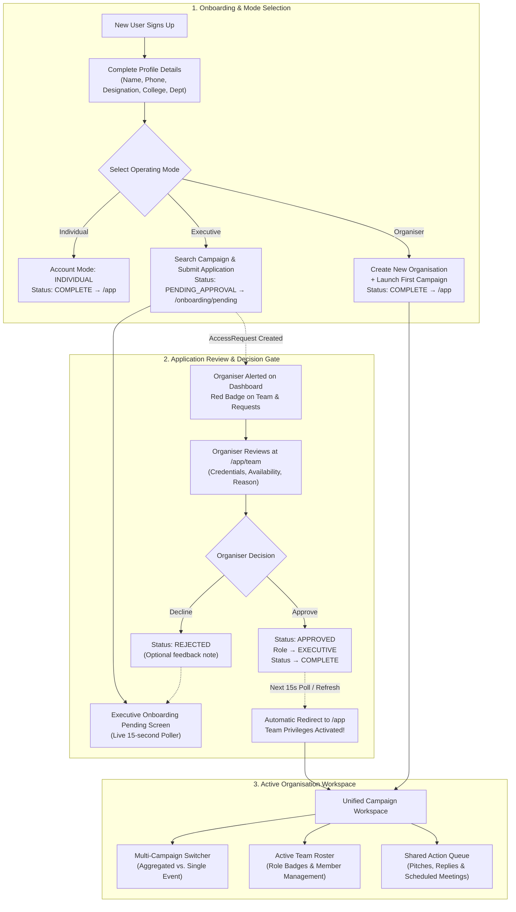

### 13.1 The Three Account Modes & Roles

| Mode / Role | Best Suited For | Key Capabilities & Permissions |
| :--- | :--- | :--- |
| **`ORGANISER`** | Lead Organizers, Presidents, Fest Convenors, Society Chairs | • Create & edit organization profiles.<br/>• Launch multiple campaigns under one organization.<br/>• Full approval authority over Executive access applications.<br/>• Remove team members and manage active rosters.<br/>• Approve pitches, dispatch emails, book meetings, and sign deals.<br/>• Access aggregated multi-campaign financial analytics. |
| **`EXECUTIVE`** | Sponsorship Committee Members, DevRel Executives, Student Volunteers | • Search for and join established campaigns.<br/>• Run AI sponsor discovery and inspect 7-factor fit scores.<br/>• Generate and edit customized email pitch drafts.<br/>• Request pitch approvals from organizers.<br/>• View inbound replies, classify intent, and log follow-ups.<br/>• View campaign schedule and participate in meetings. |
| **`INDIVIDUAL`** | Independent Organizers, Hackathon Solo Leads | • Full standalone capabilities for personal campaigns.<br/>• Zero team management overhead.<br/>• Can upgrade to `ORGANISER` or `EXECUTIVE` anytime from Settings. |

---

### 13.2 The 4 Onboarding Lifecycle States

SponFy tracks every user's journey through an explicit state machine:

```
[NOT_STARTED]  ──(Save Profile Details)──►  [DETAILS_DONE]
                                                  │
            ┌─────────────────────────────────────┴─────────────────────────────────────┐
            ▼                                     ▼                                     ▼
      (Individual)                           (Organiser)                           (Executive)
            │                                     │                                     │
            ▼                                     ▼                                     ▼
       [COMPLETE]                            [COMPLETE]                        [PENDING_APPROVAL]
       (Go to /app)                          (Go to /app)                      (Go to /onboarding/pending)
                                                                                        │
                                                                   (Organiser Approves) │
                                                                                        ▼
                                                                                   [COMPLETE]
                                                                                  (Go to /app)
```

1. **`NOT_STARTED`**: User has registered but has not yet filled out their personal profile. Visiting any protected route redirects to `/onboarding`.
2. **`DETAILS_DONE`**: Personal profile (name, phone, designation, college, department) is saved. User is ready to select their operating mode.
3. **`PENDING_APPROVAL`**: Executive has submitted an application to join a campaign. User is routed to `/onboarding/pending` while awaiting organiser review.
4. **`COMPLETE`**: User is fully activated and has direct access to `/app`.

---

### 13.3 How an Executive Applies to an Organisation (Simple Steps)

If you are joining an existing club or fest sponsorship team, follow these simple steps:

1. **Complete Profile**: Fill in your name, contact phone, college/company, department, and designation in Step 1 of [`/onboarding`](file:///src/app/onboarding/page.tsx).
2. **Select Executive Mode**: In Step 2, click **Join as Executive** to open [`/onboarding/executive`](file:///src/app/onboarding/executive/page.tsx).
3. **Search for Campaign or Club**: Use the real-time search bar to find your college festival, society, or organization by name (e.g., *DevFest*, *Apex Hackathon*, *National Tech Summit*).
4. **Select Target Campaign**: Click on your organization's campaign card from the search results.
5. **Complete Application Form**:
   - **Role in Team**: Your proposed position (e.g., *Sponsorship Lead*, *Outreach Executive*, *Corporate Relations*).
   - **Department**: e.g., *Student Council*, *ACM Student Chapter*, *Marketing Cell*.
   - **Weekly Availability**: State how many hours per week you can dedicate (e.g., *10 hrs/week*).
   - **Why Join**: A brief statement of interest explaining how you can help secure sponsors.
   - **Personal Message**: A short note to the lead organizer.
6. **Submit Application**: Click **Submit Access Request**. SponFy immediately creates a pending `AccessRequest` record and routes you to the pending screen.

---

### 13.4 The Executive Pending Screen (`/onboarding/pending`)

While waiting for the organizer to review your application:
- **Live Polling**: The pending page automatically queries `/api/access-requests/status` every **15 seconds** in the background.
- **Application Summary**: Displays the targeted campaign name, organization name, requested role, submission timestamp, and your stated credentials.
- **Instant Redirection**: The moment the organizer approves your request, the pending screen automatically detects the status change to `COMPLETE` and redirects you directly into the workspace at [`/app`](file:///src/app/(app)/app/page.tsx). No manual refresh or re-login required.
- **Cancel or Switch**: If you applied to the wrong team or wish to create your own campaign instead, click **Cancel Request** or **Choose Another Option** to return to mode selection.

---

### 13.5 How an Organiser Reviews & Approves Requests (Simple Steps)

Lead organizers have complete governance over who joins their team:

1. **Notification Badge**: When an executive submits an application, the lead organizer receives an alert badge on the dashboard button: **Team & Requests (N)**.
2. **Open Team Management**: Navigate to [`/app/team`](file:///src/app/(app)/app/team/page.tsx) and select the **Pending Requests** tab.
3. **Review Candidate Dossier**:
   - Applicant name, email, and college/company.
   - Academic or organizational department and designation.
   - Stated weekly availability (hours/week).
   - Motivation statement and direct message.
4. **Click Decision**: Click **Approve** (green checkmark) or **Decline** (red X).
5. **Add Optional Decision Note**: A modal allows the organizer to include feedback or onboarding instructions (e.g., *"Welcome to the team! Check our Slack channel for track assignments."*).
6. **Instant Multi-Table Activation**: Upon clicking confirm:
   - The request status is set to `APPROVED`.
   - The applicant's role and account mode are atomically updated to `EXECUTIVE`.
   - The applicant's onboarding status changes to `COMPLETE`.
   - Active records are created in both `OrganisationMember` and `CampaignMember`.
   - The executive is immediately granted full team privileges.

---

### 13.6 Managing Active Team Members & Roster

Within [`/app/team`](file:///src/app/(app)/app/team/page.tsx), switch to the **Active Members** tab:
- **Roster Overview**: View all approved organizers and executives, complete with designations, university affiliations, role tags, and joining dates.
- **Member Removal**: Organizers can remove any executive from the workspace by clicking the **Remove** button. The system cleanly updates their membership status to `REMOVED`, immediately revoking access to organization drafts and contacts while preserving existing audit logs.

---

### 13.7 Multi-Campaign Aggregation on Organiser Dashboard

When operating an organization with multiple events (e.g., an annual hackathon and a mid-year technical summit):
- **Aggregated View (`All Campaigns`)**:
  - Blends KPIs across all events: total sponsors in pipeline, emails dispatched, overall reply rate, meetings booked, and total committed funding.
  - Displays side-by-side progress bars comparing each campaign's progress toward its target.
- **Single-Campaign Filter**:
  - Use the campaign switcher dropdown in the dashboard header to focus on one specific event.
  - Dynamically filters the **Today Action Queue**, sponsor pipeline, drafts, and calendar to that selected campaign.
- **Launch New Campaigns**:
  - Click **+ New Campaign** in the switcher dropdown to spin up an additional campaign under your existing organization without re-entering organization details.

---

### 13.8 Role & Permission Security Matrix

| Feature / Action | `ORGANISER` | `EXECUTIVE` | `INDIVIDUAL` | `ADMIN` |
| :--- | :---: | :---: | :---: | :---: |
| **Create / Edit Organisation Profile** | ✅ | ❌ | ❌ | ✅ |
| **Launch New Event Campaigns** | ✅ | ❌ | ✅ | ✅ |
| **Approve / Decline Team Access Requests** | ✅ | ❌ | ❌ | ✅ |
| **Remove Team Members** | ✅ | ❌ | ❌ | ✅ |
| **Switch Between Multi-Campaign Views** | ✅ | ❌ | ❌ | ✅ |
| **Run AI Sponsor Discovery & Research** | ✅ | ✅ | ✅ | ✅ |
| **Generate & Edit Email Pitch Drafts** | ✅ | ✅ | ✅ | ✅ |
| **Grant Final Approval to Send Draft** | ✅ | ✅ | ✅ | ✅ |
| **Dispatch Emails via Gmail API** | ✅ | ✅ | ✅ | ✅ |
| **View Inbound Replies & Classify Intent** | ✅ | ✅ | ✅ | ✅ |
| **Schedule Meetings on Calendar** | ✅ | ✅ | ✅ | ✅ |
| **View Revenue Pipeline & Analytics** | ✅ | ✅ (Campaign) | ✅ | ✅ (All) |
| **Access Platform-Wide Admin Console (`/admin`)** | ❌ | ❌ | ❌ | ✅ |

---

## 14. Local Development Quickstart

### 1. Clone Repository & Install Dependencies
```bash
git clone https://github.com/subratoghosh/SponFy.git
cd SponFy
npm ci
```

### 2. Configure Local Environment
```bash
cp .env.example .env.local
```

### 3. Initialize Database
```bash
npx prisma generate
npx prisma db push
```

### 4. Execute Verification Suite
```bash
npm test              # Run all 174 Vitest unit, regression & security tests
npm run typecheck     # Verify TypeScript types (tsc --noEmit)
npm run lint          # Run ESLint validation
```

### 5. Launch Development Server
```bash
npm run dev
```
Open [http://localhost:3000](http://localhost:3000) in your browser.

---

## Environment Configuration Reference

| Variable | Description | Required in Production |
| :--- | :--- | :---: |
| `SITE_URL` | Canonical origin (e.g. `https://sponfy.vercel.app`) | Yes |
| `DATABASE_URL` | Neon PostgreSQL pooled connection string (`?sslmode=require`) | Yes |
| `DIRECT_URL` | Neon PostgreSQL direct unpooled connection string (for migrations) | Yes |
| `AUTH_SECRET` | 32+ character random secret for signing NextAuth JWT sessions | Yes |
| `TOKEN_ENCRYPTION_KEY` | 64-character hex string for AES-256-GCM token encryption | Yes |
| `ADMIN_EMAILS` | Comma-separated admin emails verified on server side | Yes |
| `GOOGLE_CLIENT_ID` | Google Cloud OAuth Client ID for Gmail API & Sign In | Yes |
| `GOOGLE_CLIENT_SECRET` | Google Cloud OAuth Client Secret | Yes |
| `UPSTASH_REDIS_REST_URL` | Upstash Redis REST endpoint for distributed rate limiting | Yes |
| `UPSTASH_REDIS_REST_TOKEN` | Upstash Redis REST authentication token | Yes|
| `GROQ_API_KEY` | Groq API key for Llama 3.3 70B fast scoring | Yes |
| `GEMINI_API_KEY` | Google Gemini API key for deep dossier synthesis | Yes |
| `TAVILY_API_KEY` | Tavily Search API key for real-time web discovery | Yes |

---

## License

MIT License. Designed and engineered for student organizers and tech community leaders worldwide.
