# SponFy — AI Sponsorship Operating System & Intelligence Platform

[](https://www.typescriptlang.org/)
[](https://nextjs.org/)
[](https://github.com/langchain-ai/langgraphjs)
[](https://vitest.dev/)
[](https://csrc.nist.gov/publications/detail/sp/800-38d/final)
[](LICENSE)

SponFy is an enterprise-grade sponsorship operating system built for college hackathons, technical conferences, academic summits, and student developer organizations. Powered by multi-model artificial intelligence, live web research extraction, and human-in-the-loop safety gates, SponFy streamlines the entire sponsorship lifecycle—from automated discovery and explainable fit scoring to deliverability-guaranteed outreach, inbound reply intelligence, meeting scheduling, and pipeline revenue tracking.

---

## Visual Table of Contents

| Section | Visual Type | Focus Area |
| :--- | :--- | :--- |
| **[1. End-to-End System Architecture](#1-end-to-end-system-architecture)** | System Flow Diagram | Global Edge, Serverless Compute, AI Engine, Storage |
| **[2. LangGraph & Multi-Model AI Pipeline](#2-langgraph--multi-model-ai-orchestration-pipeline)** | Orchestration Flowchart | Parallel web search, Llama 3.3 scoring, Gemini extraction |
| **[3. Six-Step Send-Guard Security Engine](#3-six-step-send-guard-security-engine)** | Gate Decision Flowchart | Non-bypassable human approvals, spacing, and quotas |
| **[4. Multi-Layer Deliverability Shield](#4-multi-layer-deliverability-shield)** | Verification Pipeline | DNS MX, SPF/DMARC, disposable filters, and AI check |
| **[5. 7-Factor Fit Scoring Breakdown](#5-transparent-7-factor-fit-scoring-algorithm)** | Mermaid Pie Chart & Matrix | 0–100 explainable sponsor evaluation breakdown |
| **[6. Inbound Reply & Intent Intelligence](#6-real-time-reply-sync--intent-classification-engine)** | NLP Decision Machine | Automation intent classification and question extraction |
| **[7. 4-Touch Follow-Up Cadence & Circuit Breakers](#7-automated-4-touch-follow-up-engine--circuit-breakers)** | Lifecycle Timeline Flow | Scheduled cadence and real-time auto-halting triggers |
| **[8. Meeting Scheduler & Morning Reminders](#8-meeting-calendar-scheduler--overview-reminders)** | Interaction Flowchart | Big calendar multi-slot scheduling and login popups |
| **[9. AES-256-GCM Cryptographic Vault](#9-cryptographic-storage--token-security-vault)** | Sequence Diagram | OAuth token encryption, IV handling, and tamper defense |
| **[10. Platform vs. Custom Architecture Matrix](#10-platform-infrastructure-vs-custom-engineered-components)** | Structured Comparison | Vercel Edge capabilities vs. bespoke SponFy modules |
| **[11. CI/CD DevOps & Test Pipeline](#11-continuous-integration--devops-pipeline)** | Build Pipeline Flow | GitHub Actions, TypeScript verification, and 174 tests |
| **[12. Quickstart & Environment Setup](#12-local-development-quickstart)** | Code Configuration | Step-by-step local bootstrap and environment schema |

---

## 1. End-to-End System Architecture

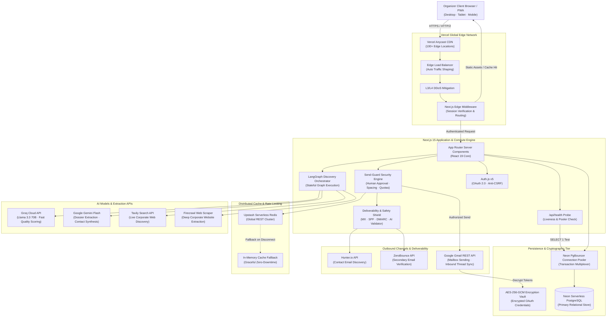

---

## 2. LangGraph & Multi-Model AI Orchestration Pipeline

SponFy integrates **LangGraph** as an orchestration layer over live discovery and dossier synthesis, executing parallel web research, fast LLM relevance filtering, and deep factual synthesis.

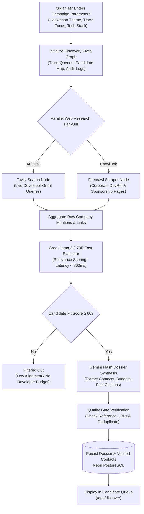

---

## 3. Six-Step Send-Guard Security Engine

To eliminate unauthorized spam and accidental transmissions, **all outbound emails** must pass through a strict, pure-function validation chain executed entirely on the server.

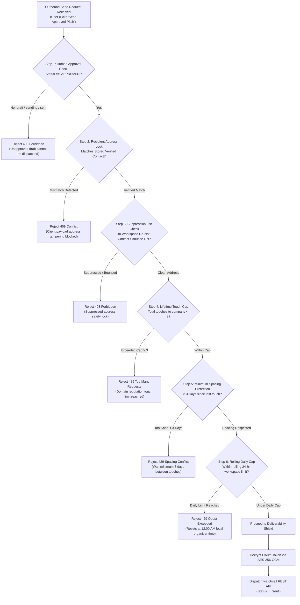

---

## 4. Multi-Layer Deliverability Shield

Bounces permanently harm domain reputation. SponFy prevents bad sends before they leave the application:

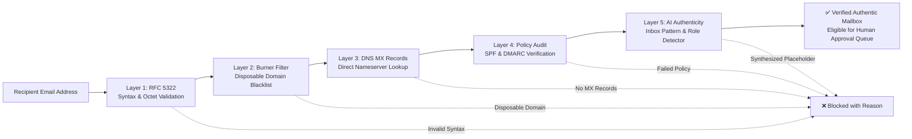

---

## 5. Transparent 7-Factor Fit Scoring Algorithm

Prospective sponsors are scored on an explainable **0–100** scale across seven dimensions before entering the outreach pipeline:

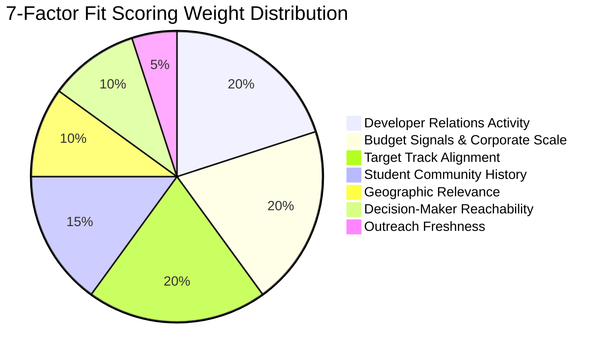

### Scoring Criteria Matrix

| Dimension | Weight | Signals Analyzed | Target Threshold |
| :--- | :---: | :--- | :--- |
| **Developer Relations Activity** | **20%** | Active developer advocates, GitHub initiatives, OSS programs | Recent active hackathon involvement |
| **Budget Signals & Scale** | **20%** | Recent funding rounds, dedicated university grants, hiring | Verified student grant budgets |
| **Target Track Alignment** | **20%** | Semantic match between API/product and hackathon tracks | High relevance to student projects |
| **Student Community History** | **15%** | Track record of sponsoring college clubs, summits, or fellows | Prior university sponsorship evidence |
| **Geographic Relevance** | **10%** | Regional developer hubs, regional hiring campaigns | Event country or global remote policy |
| **Decision-Maker Reachability** | **10%** | Verified DevRel, University Relations, or Tech Recruiting emails | Named contact with public role |
| **Outreach Freshness** | **5%** | Recency of last public sponsorship announcement | Partnership announced in past 6 months |

---

## 6. Real-Time Reply Sync & Intent Classification Engine

SponFy actively listens for incoming replies across connected Gmail threads and passes incoming text through an NLP intent classification pipeline:

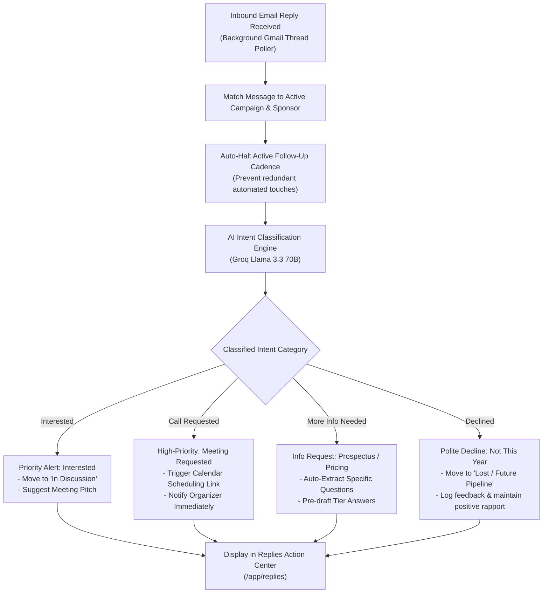

---

## 7. Automated 4-Touch Follow-Up Engine & Circuit Breakers

A structured 4-touch cadence ensures maximum reply rates while strictly protecting sender reputation. Any inbound activity triggers an immediate circuit breaker.

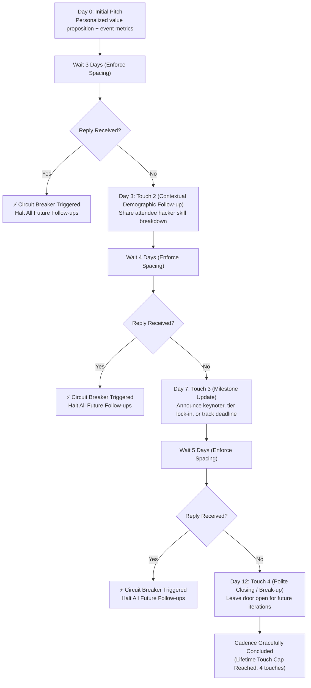

---

## 8. Meeting Calendar Scheduler & Overview Reminders

Organizers can manage all sponsor meetings through an interactive, full-screen calendar with morning reminder notifications on login.

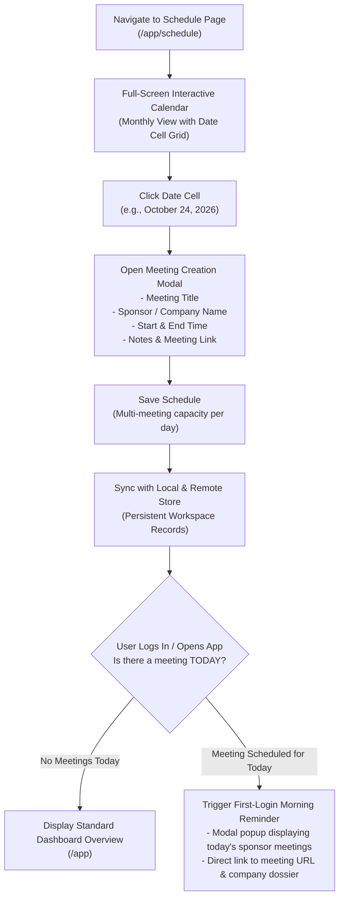

---

## 9. Cryptographic Storage & Token Security Vault

All OAuth refresh tokens and sensitive API keys are encrypted at rest using **AES-256-GCM** with authenticated tamper verification.

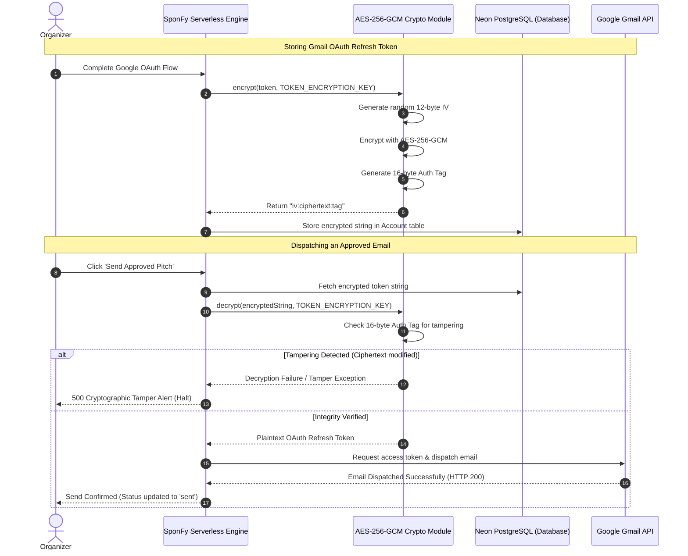

---

## 10. Platform Infrastructure vs. Custom-Engineered Components

SponFy achieves high availability by cleanly dividing concerns between Vercel's global platform infrastructure and custom-engineered business logic.

```mermaid
graph LR
    subgraph PlatformInfrastructure ["Platform-Provided (Vercel Global)"]
        P1["Anycast Global CDN<br/>(100+ Edge Locations)"]
        P2["Edge Load Balancing<br/>(Auto Request Routing)"]
        P3["Serverless Auto-Scaling<br/>(0 to Hundreds of Instances)"]
        P4["L3/L4 DDoS Mitigation<br/>(Volumetric Attack Defense)"]
        P5["Edge Middleware<br/>(Sub-10ms Session Check)"]
    end

    subgraph CustomEngineered ["Custom-Engineered (SponFy Core)"]
        C1["Send-Guard Security Engine<br/>(Pure-function safety gate)"]
        C2["Deliverability Shield<br/>(MX / SPF / DMARC verification)"]
        C3["LangGraph Discovery Engine<br/>(Stateful multi-model AI graph)"]
        C4["AES-256-GCM Crypto Vault<br/>(Tamper-evident token security)"]
        C5["Midnight Quota Engine<br/>(Rolling 12:00 AM reset calculator)"]
        C6["7-Factor Fit Scoring<br/>(0–100 explainable sponsor rating)"]
    end

    PlatformInfrastructure -->|Low Latency Routing & Protection| CustomEngineered
```

---

## 11. Continuous Integration & DevOps Pipeline

Every pull request and commit to `main` undergoes an automated multi-stage verification pipeline to ensure zero regressions:

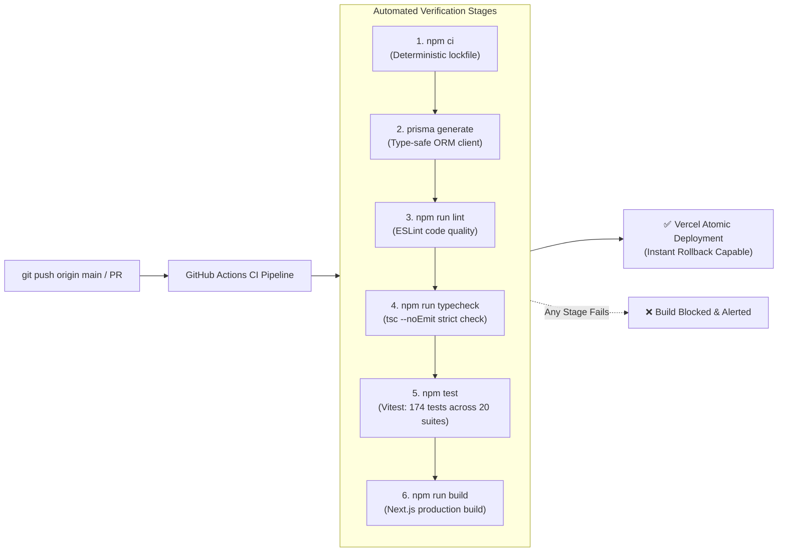

---

## 12. Local Development Quickstart

### 1. Clone Repository & Install Dependencies
```bash
git clone https://github.com/subratoghosh/SponFy.git
cd SponFy
npm ci
```

### 2. Configure Local Environment
```bash
cp .env.example .env.local
```

### 3. Initialize Database
```bash
npx prisma generate
npx prisma db push
```

### 4. Execute Verification Suite
```bash
npm test              # Run all 174 Vitest unit, regression & security tests
npm run typecheck     # Verify TypeScript types (tsc --noEmit)
npm run lint          # Run ESLint validation
```

### 5. Launch Development Server
```bash
npm run dev
```
Open [http://localhost:3000](http://localhost:3000) in your browser.

---

## Environment Configuration Reference

| Variable | Description | Required in Production |
| :--- | :--- | :---: |
| `SITE_URL` | Canonical origin (e.g. `https://sponfy.vercel.app`) | Yes |
| `DATABASE_URL` | Neon PostgreSQL pooled connection string (`?sslmode=require`) | Yes |
| `DIRECT_URL` | Neon PostgreSQL direct unpooled connection string (for migrations) | Yes |
| `AUTH_SECRET` | 32+ character random secret for signing NextAuth JWT sessions | Yes |
| `TOKEN_ENCRYPTION_KEY` | 64-character hex string for AES-256-GCM token encryption | Yes |
| `ADMIN_EMAILS` | Comma-separated admin emails verified on server side | Yes |
| `GOOGLE_CLIENT_ID` | Google Cloud OAuth Client ID for Gmail API & Sign In | Yes |
| `GOOGLE_CLIENT_SECRET` | Google Cloud OAuth Client Secret | Yes |
| `UPSTASH_REDIS_REST_URL` | Upstash Redis REST endpoint for distributed rate limiting | Recommended |
| `UPSTASH_REDIS_REST_TOKEN` | Upstash Redis REST authentication token | Recommended |
| `GROQ_API_KEY` | Groq API key for Llama 3.3 70B fast scoring | Yes |
| `GEMINI_API_KEY` | Google Gemini API key for deep dossier synthesis | Yes |
| `TAVILY_API_KEY` | Tavily Search API key for real-time web discovery | Yes |

---

## License

MIT License. Designed and engineered for student organizers and tech community leaders worldwide.
